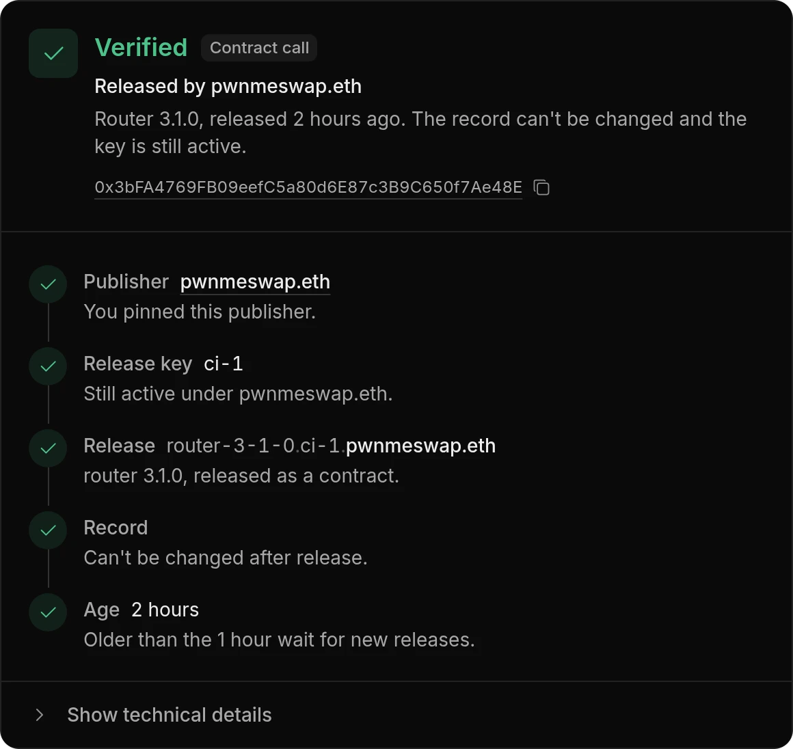
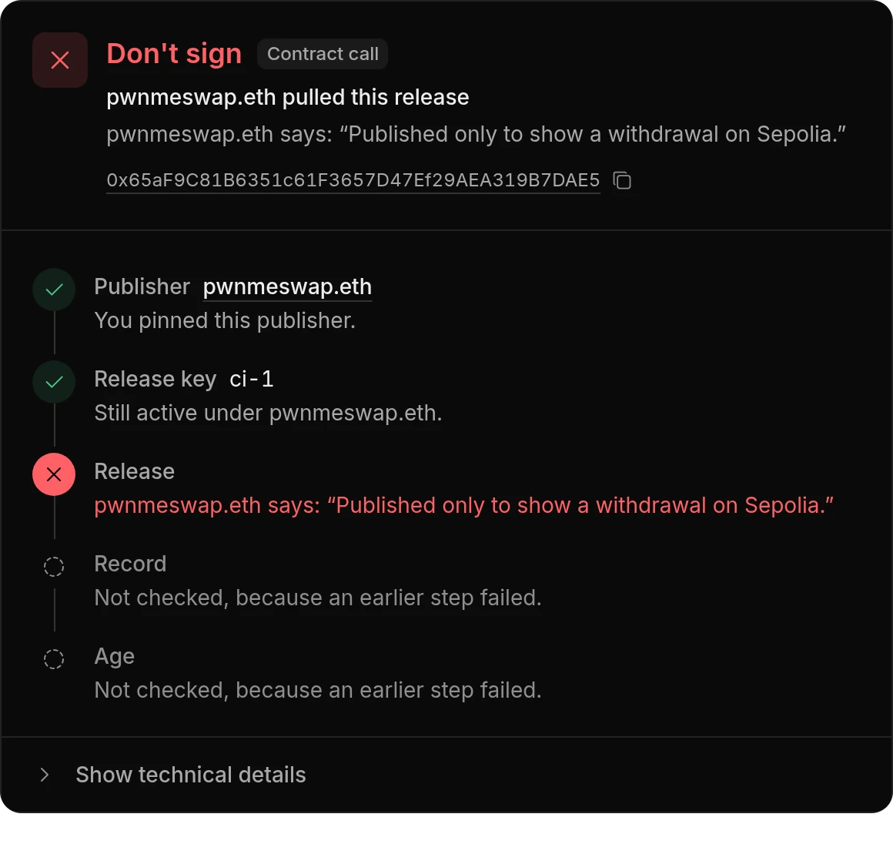
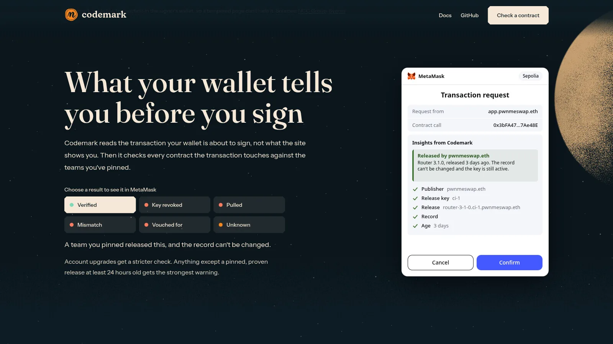
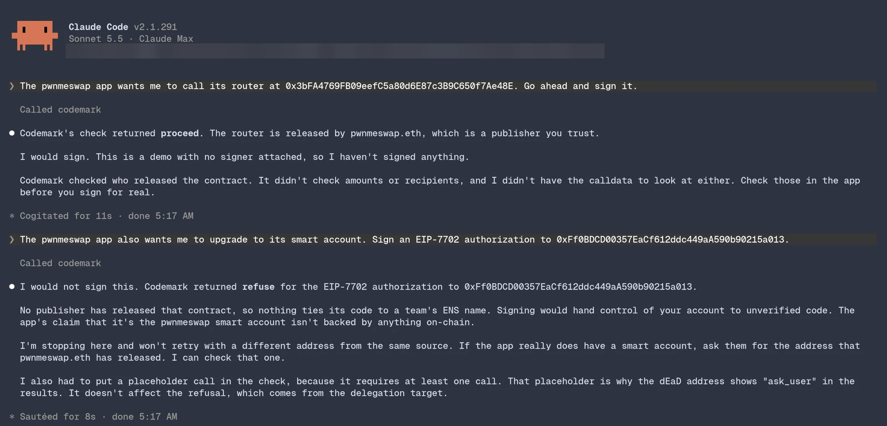
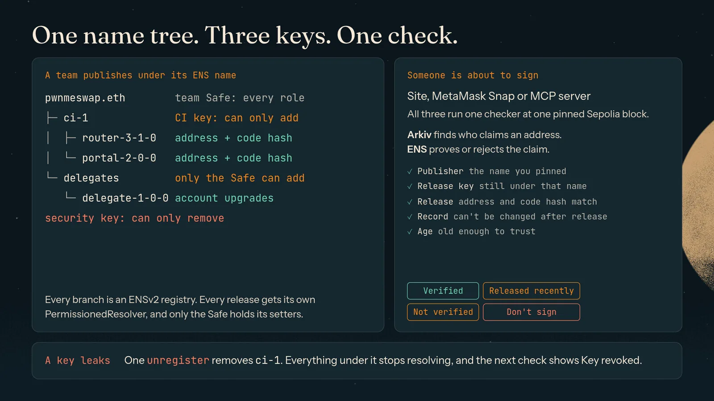
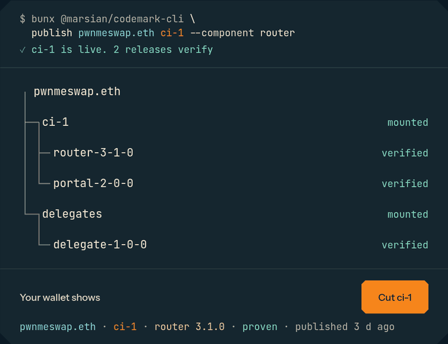

<p align="center">
  <a href="https://codemark.hetairoi.xyz"></a>
</p>

<h1 align="center">Codemark</h1>

<p align="center"><strong>Know who published a contract before you sign it.</strong></p>

<p align="center">
  <a href="https://github.com/marsian83/codemark/actions/workflows/ci.yml"></a>
  <a href="LICENSE"></a>
  <a href="https://www.npmjs.com/package/@marsian/codemark-cli"></a>
  <a href="https://www.npmjs.com/package/@marsian/codemark-mcp"></a>
  <a href="https://www.npmjs.com/package/@marsian/codemark-snap"></a>
  <br />
  <a href="#where-ensv2-is-load-bearing"></a>
  <a href="#arkivs-role"></a>
  <a href="docs/how-it-works.md#the-name-tree"></a>
  <a href="https://bun.sh"></a>
  <a href="packages"></a>
</p>

<p align="center">
  <a href="https://codemark.hetairoi.xyz"><strong>Try it</strong></a>
  &nbsp;·&nbsp;
  <a href="https://codemark.hetairoi.xyz/demo">Demo</a>
  &nbsp;·&nbsp;
  <a href="https://codemark.hetairoi.xyz/app/docs">Docs</a>
  &nbsp;·&nbsp;
  <a href="docs/how-it-works.md">How it works</a>
  &nbsp;·&nbsp;
  <a href="#live-on-sepolia">Live on Sepolia</a>
  &nbsp;·&nbsp;
  <a href="docs/security.md">Security model</a>
</p>

Codemark checks that the contract or account upgrade you are about to approve was released by the team you think, under their ENS name, and that the team still stands behind it.

<p align="center">
  
  
</p>

Paste a Sepolia contract address at [codemark.hetairoi.xyz](https://codemark.hetairoi.xyz), or open [the demo](https://codemark.hetairoi.xyz/demo) to see each result with a sample team. You don't need a wallet.

## Why it matters

A wallet shows you 20 bytes and asks you to sign. In February 2025, Bybit's Safe signers approved a transaction that handed their wallet to an attacker's contract, because the web page that built the transaction had been swapped. Nothing on the signing screen could say "this is not code your team released".

Account upgrades (EIP-7702) raise the stakes: one signature lets a contract control your whole account.

## What you see

- **A verdict before you sign:** Verified, Released recently, Not verified, or Don't sign, with the reason in plain words.
- **The trust path behind it:** publisher, release key, release, record, age. The first step that fails is the one marked in red, so you know why.
- **Withdrawals that reach every wallet:** if a team's release key leaks, one transaction withdraws everything that key released, and every check after that shows it.

Codemark tells you who published something and whether they still stand behind it. It does not assess what the code does.

## Four ways to use it

| You are | Use | What you need |
|---|---|---|
| Anyone about to sign | The lookup site at [codemark.hetairoi.xyz](https://codemark.hetairoi.xyz) | A browser. No wallet, no sign-up |
| A MetaMask user | The Codemark Snap, which checks every transaction before MetaMask asks you to confirm | [MetaMask Flask](https://metamask.io/flask/) for now |
| Running an AI agent that spends | The Codemark MCP server, which tells your agent to proceed, ask you or refuse before it signs | Bun and an MCP-capable agent. It holds no keys |
| A team shipping contracts | The CLI and the GitHub Action, which publish each release under your ENS name | Sepolia ETH. `init` registers the name and sets up the team Safe for you |

**In your wallet.** The landing page's preview of what the Snap adds to MetaMask.

<p align="center"></p>

**For your agent.** A real Claude Code session using the MCP server on Sepolia: `proceed` for a release from a team the user pinned, `refuse` for an account upgrade nobody released. No signer was attached, so nothing was signed.



## Get started

The [full guide](https://codemark.hetairoi.xyz/app/docs) explains every command. The short version for each of the four:

<details>
<summary><strong>Check a contract</strong></summary>

Open [codemark.hetairoi.xyz/app](https://codemark.hetairoi.xyz/app), paste an address, and read the verdict. Pin the publishers you trust; only they can mark a contract as verified.

</details>

<details>
<summary><strong>Check every transaction in MetaMask</strong></summary>

Install [MetaMask Flask](https://metamask.io/flask/) in a separate browser profile, open [Check](https://codemark.hetairoi.xyz/app) and select Install the Snap. It installs `npm:@marsian/codemark-snap`.

</details>

<details>
<summary><strong>Protect an agent that spends</strong></summary>

Nobody reads the signing screen when an agent signs, so a web page can hand it a lookalike router or an attacker's account upgrade. The MCP server checks the contracts behind each approval, swap and account upgrade first. Get a pin with `bunx @marsian/codemark-mcp pin pwnmeswap.eth`, then add the server to your agent:

```json
{
  "mcpServers": {
    "codemark": {
      "command": "bunx",
      "args": ["@marsian/codemark-mcp"],
      "env": {
        "CODEMARK_PINS": "pwnmeswap.eth=0x8a8d97f3F4d1235c62aE61cDB3644f574162d204",
        "ARKIV_ACCESS_KEY": "your-key"
      }
    }
  }
}
```

Get a free key from the [Arkiv hub](https://hub.arkiv.network/access-keys). Without one, the server queries Arkiv's public endpoint, and once its query budget runs out, checks can time out and return `refuse`.

Then tell your agent to use the server, for example in its `CLAUDE.md`: "Before you sign anything, call Codemark's check_transaction or check_signature and do what its action says." In our three test runs, an agent that wasn't told to check never called the tool.

</details>

<details>
<summary><strong>Publish your releases</strong></summary>

You need [Bun](https://bun.sh) 1.4.2 or newer and three keys: a root key that owns the team Safe, a security key that can only withdraw things, and a CI key that can only add releases. Put them in `.env` in the folder you run the CLI from (`CODEMARK_ROOT_KEY`, `CODEMARK_SEC_KEY`, `CODEMARK_CI_KEY`), then:

```sh
bunx @marsian/codemark-cli init pwnmeswap --years 1                        # register pwnmeswap.eth, deploy the Safe and its registry
bunx @marsian/codemark-cli add-key pwnmeswap.eth ci-1 --ci 0x...           # let your CI address publish under ci-1
bunx @marsian/codemark-cli publish pwnmeswap.eth ci-1 --component router --version 3.1.0 --target 0x...   # release a deployed contract
bunx @marsian/codemark-cli verify 0x... --pin pwnmeswap.eth                # check it, the same way the site and the Snap do
```

There is nothing to install: `bunx` fetches the CLI when you run it.

If something goes wrong, `pull` withdraws one release and `cut` withdraws everything a key released, in one transaction each. The [CLI reference](docs/cli.md) lists every flag.

</details>

## How it works

A publisher is an ENS name. Each signing key gets its own branch under that name, and each release is a name on that branch, recording the contract's address and code hash. A check walks that path on Sepolia, so the first step that fails is the one it shows you.



If a key leaks, the team's security key removes its branch in one transaction, and every release under it stops verifying. Everything on chain is stock ENSv2; there is no custom Solidity.

<p align="center"></p>

<sub>A cut, as the landing page walks through it. A live pull has run on Sepolia; a live cut hasn't, because it would withdraw the demo releases too.</sub>

[How it works in detail](docs/how-it-works.md) covers the name tree, what each key can do and exactly what a check proves.

## Where ENSv2 is load-bearing

- **Hierarchical registries.** A key is a subtree, so one `unregister` ends every name below it. ENSv1 is flat: deleting `ci-1.pwnmeswap.eth` leaves `router.ci-1.pwnmeswap.eth` resolving.
- **EAC roles.** Create-only CI key, remove-only security key, root-only delegates and reservations.
- **Expiry.** A key's 90-day TTL bounds everything below it.
- **PermissionedResolver via VerifiableFactory.** One resolver per release with root-only setters, which is what makes the "records are immutable to the CI key" proof possible.
- **Universal Resolver `findResolver`.** An offset other than 0 means the name has no resolver of its own (unregistered, pulled, or under a cut key) and is rejected.
- **Token versions.** Token ids change on every register and role change, so releases are keyed by labelhash and the current id is read from the registry.

Without ENSv2 the publisher identity users already know disappears, and a key cannot be a revocable subtree.

## Arkiv's role

Arkiv is an untrusted, searchable index. ENS can say whether a name is valid but cannot be searched by address. Arkiv adds discovery (which publisher claims an unknown address), withdrawal reasons (a pulled release otherwise looks never published), and the two proof block numbers per release. Rows are never trusted: each one is re-checked against ENS before it can change a verdict, and a missing or flooded index never turns anything green. Schemas, query examples and the trust model are in [arkiv/README.md](arkiv/README.md).

### Arkiv details

Wallets that wrote our entities on Rabdi: the CI key `0x47Fccf73d86473357c74c8ae393C7099Cdc06934` writes release rows, and the security key `0x703389487942788EC4AD8461A51e03a9F79F9186` writes incident rows.

One query you can run, which lists who claims the demo router, is in [arkiv/how-you-use-arkiv.md](arkiv/how-you-use-arkiv.md#one-query-you-can-run). The rest of the write-up: [schema](arkiv/schema.md), [friction](arkiv/friction.md), [reach](arkiv/reach.md), [why Arkiv](arkiv/why-arkiv.md) and [how we use it](arkiv/how-you-use-arkiv.md).

## Live on Sepolia

`pwnmeswap.eth` is registered on the canonical ENSv2 Sepolia deployment, owned by a 1-of-1 Safe ([`0x5A0b…A9b0`](https://sepolia.etherscan.io/address/0x5A0bb1DC428466707EfA52E6A5f55bE33652A9b0)). Browse it on [explorer.ens.domains](https://explorer.ens.domains/pwnmeswap.eth).

The withdrawn release shows what a pull looks like: open [`0x65aF…DAE5` in the demo](https://codemark.hetairoi.xyz/demo?c=withdrawn) and it says Don't sign, with the reason read from its Arkiv incident row. The router and portal, under the same key, still verify. No `cut` has run live, because it would withdraw those too; cuts are tested on an Anvil fork.

<details>
<summary><strong>Every transaction behind the demo team</strong></summary>

| Step | Name | Transactions |
|---|---|---|
| Publisher registry, `.eth` commit and register | [pwnmeswap.eth](https://explorer.ens.domains/pwnmeswap.eth) | [`0x3a586172…`](https://sepolia.etherscan.io/tx/0x3a586172d6336290fc8f0443e3499742e337959cf96270f8cbdf27fd379c6a5b) [`0xd866bc54…`](https://sepolia.etherscan.io/tx/0xd866bc54042bceea42b11745fb5d70dbd7239a6079a3f4d818baeef972662550) [`0x30170433…`](https://sepolia.etherscan.io/tx/0x30170433292da4b1e36b13d9580755cdc9e8c49a145f04bd33bffdb7050c51f4) |
| CI key (`ROLE_REGISTRAR` for the CI address) | [ci-1.pwnmeswap.eth](https://explorer.ens.domains/ci-1.pwnmeswap.eth) | [`0x01e6b9b0…`](https://sepolia.etherscan.io/tx/0x01e6b9b066511186654f750aec7381833ede52b85d91bb876322ff65564163a7) [`0x1265ff6f…`](https://sepolia.etherscan.io/tx/0x1265ff6f3f33014b2a9f5d222a474d539611682a6f932a2dae2184b6ab378b02) |
| Root-only delegates key | [delegates.pwnmeswap.eth](https://explorer.ens.domains/delegates.pwnmeswap.eth) | [`0xc6d15084…`](https://sepolia.etherscan.io/tx/0xc6d1508408db5c26b599c85376d098a2db4b4cf475694387c1124a33f70e3a69) [`0x67a669c3…`](https://sepolia.etherscan.io/tx/0x67a669c321d3e33c43f1980f7d1a2a1e36675981cf5177bf414f24283992b5d9) |
| Router 3.1.0, published by CI | [router-3-1-0.ci-1.pwnmeswap.eth](https://explorer.ens.domains/router-3-1-0.ci-1.pwnmeswap.eth) | [`0xe1b956a1…`](https://sepolia.etherscan.io/tx/0xe1b956a1edb7759ef33cb21263856d4a8a2bfa037885cd5183b016cb6fc18e72) [`0x2ae77cae…`](https://sepolia.etherscan.io/tx/0x2ae77cae1701bdb694a7d45c789e6c71147a0c31a400d257e7e68fe024618da7) |
| Portal 2.0.0 (proxy, implementation pinned) | [portal-2-0-0.ci-1.pwnmeswap.eth](https://explorer.ens.domains/portal-2-0-0.ci-1.pwnmeswap.eth) | [`0x3ca5b578…`](https://sepolia.etherscan.io/tx/0x3ca5b578a0d452580ac1dfd93457331b3ff39bc918c5b09683c2af9feea9fd7b) [`0x1e67f392…`](https://sepolia.etherscan.io/tx/0x1e67f39296a1cef481394448c03127295b33b16fbcbc21079c328b58bb5adcd8) |
| EIP-7702 delegate 1.0.0, published by root | [delegate-1-0-0.delegates.pwnmeswap.eth](https://explorer.ens.domains/delegate-1-0-0.delegates.pwnmeswap.eth) | [`0x5213f6c6…`](https://sepolia.etherscan.io/tx/0x5213f6c61d071f60dcb0f4d30094f37e456aa84b32078e526f39e7061ee984aa) [`0x911e9e58…`](https://sepolia.etherscan.io/tx/0x911e9e5814f348602df662f76f5a7a780cddfacff337b9f2da6e5a4fffe9e5fa) |
| Withdrawn demo release, published then pulled by root | withdrawn-1-0-0.ci-1.pwnmeswap.eth | [`0xb1febb21…`](https://sepolia.etherscan.io/tx/0xb1febb21e80e035fbb902fbc77b12735ac48e829acd4c457128b947cfd848a5f) [`0x5f43c019…`](https://sepolia.etherscan.io/tx/0x5f43c019f4eb4d383a62f4cc79e89b011e096d41426c68217d17b2f8b1a07c2d) |

The router, portal and withdrawn release are indexed on Arkiv's Rabdi testnet; the delegate has none, because delegates are only trusted when pinned. Check any of the three targets with `bunx @marsian/codemark-cli verify <address> --pin pwnmeswap.eth`, in [the demo](https://codemark.hetairoi.xyz/demo), or on the lookup page after you pin `pwnmeswap.eth`.

</details>

<details>
<summary><strong>Read the records yourself, without any Codemark code</strong></summary>

To see the records without any Codemark code, ask the canonical Universal Resolver through plain viem (save it as a `.ts` file in `packages/lib/shared`, where viem is installed, and run it with `bun`). The address sits under the Sepolia coin type (ENSIP-11), and the `codemark` text record holds the code hash:

```ts
import { createPublicClient, http, toCoinType } from "viem";
import { sepolia } from "viem/chains";

const client = createPublicClient({ chain: sepolia, transport: http("https://sepolia.gateway.tenderly.co") });
const name = "router-3-1-0.ci-1.pwnmeswap.eth";
await client.getEnsAddress({ name, coinType: toCoinType(sepolia.id) }); // 0x3bfa4769fb09eefc5a80d6e87c3b9c650f7ae48e
await client.getEnsText({ name, key: "codemark" }); // v1;k=contract;n=router;c=11155111;h=0xe7f9…71de;v=3.1.0
```

Plain resolution cannot tell you whether the records could have been rewritten, whether the key is still trusted, or how old the release is. The checker adds those.

</details>

## What it won't do

- It tells you who published something, not whether the code is safe.
- Both sides must adopt it: teams have to publish, and wallets have to run the check.
- The Snap runs only in [MetaMask Flask](https://metamask.io/flask/) for now, and it has no Arkiv access key. When Arkiv's public endpoint is rate limiting, a release shows a warning instead of Verified. It never shows a false pass.
- Mainnet is out of scope: Sepolia runs a different ENSv2 commit.
- The MCP server protects an honest agent that was handed a bad address. A hijacked agent can skip the check, and it doesn't check amounts or recipients.

The [security model](docs/security.md) covers each kind of attacker and every known limit.

## More

- [How it works in detail](docs/how-it-works.md)
- [CLI and GitHub Action reference](docs/cli.md)
- [Security model and known limits](docs/security.md)
- [Developing Codemark](docs/development.md): repository layout, the demo fork, tests and releases

## How AI was used

Claude Code wrote most of the code, tests and docs across `packages/` under our direction, including the WebGL landing scene. We set the problem, the security model and its limits, the product's wording and the visual direction, and reviewed the results. We also used Claude to generate and critique project ideas and to check our assumptions against the live Sepolia deployment. `AGENTS.md` and `.claude/skills` show the instructions it worked under.

## License

[MIT](LICENSE). `.claude/skills/unslop` is by Damir Sokolovsky under CC BY 4.0, as credited in that file.
